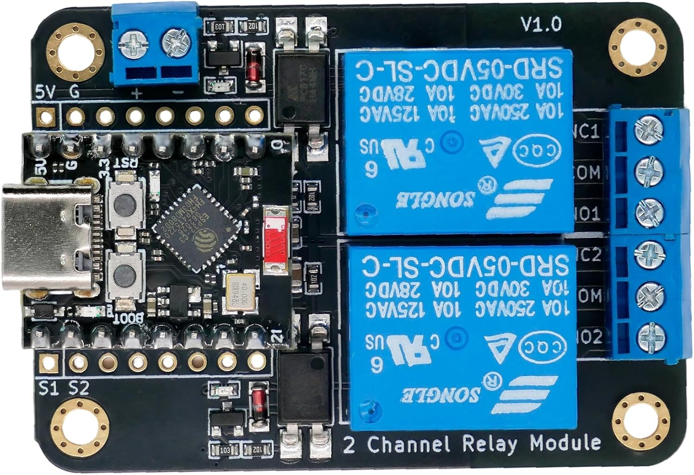
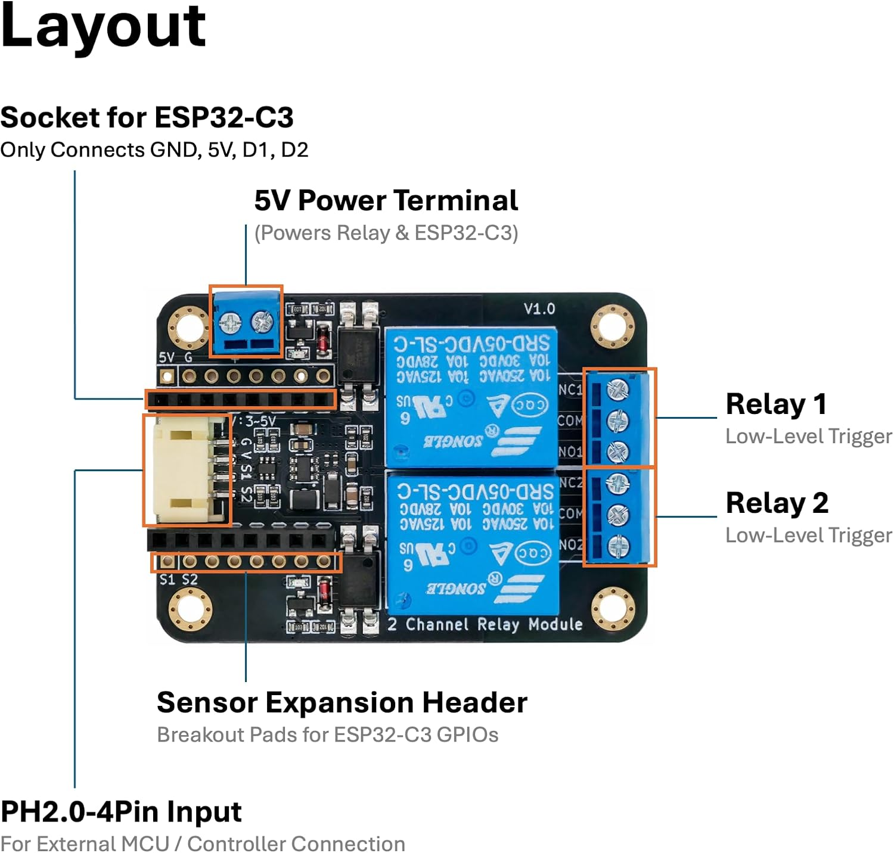
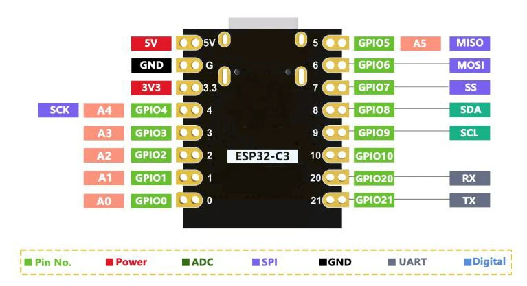
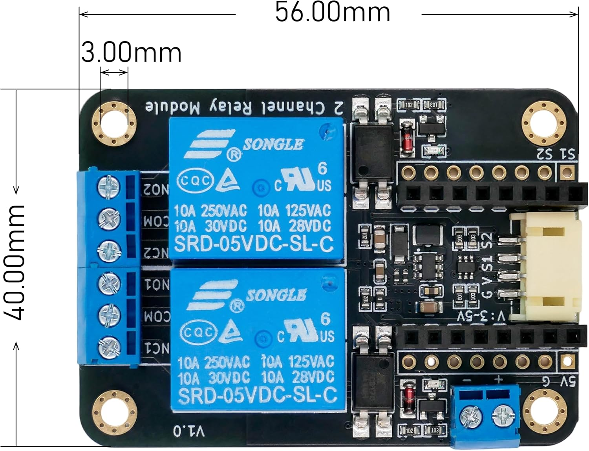

# ESP32-C3 2-Channel Relay Module

> A plug-and-play low-level trigger relay board purpose-built for the ESP32-C3 — zero breadboard wiring, native ESPHome & Home Assistant support.

<p align="center">
  
</p>

[](https://esphome.io)
[](https://www.home-assistant.io)
[](https://www.espressif.com)
[](LICENSE)

---

## Why This Module?

Most relay projects start the same way — a breadboard, a pile of jumper wires, an ESP32 dev board, a separate relay module, and a frustrating half hour of tracing which wire goes where. **This board eliminates all of that.**

Plug your ESP32-C3 directly into the onboard socket and you're done. Power, ground, and both relay control signals are connected through the header — no soldering, no wiring mistakes, no floating GPIOs.

---

## Features

| Feature | Detail |
|---|---|
| 🎯 **Direct Plug-and-Play** | Onboard female header socket maps directly to ESP32-C3 5V, GND, S1 (GPIO5), S2 (GPIO6) |
| 🏠 **ESPHome & HA Native** | Pre-built YAML configs included; auto-discovery in Home Assistant via the ESPHome dashboard |
| ⚡ **Dual Power Input** | Type-C USB **or** 5V screw terminal — use whichever fits your enclosure |
| 🔀 **4 Operating Modes** | USB-powered, terminal-powered, external MCU (PH2.0-4Pin), or sensor expansion |
| 🛡 **Optocoupler Isolation** | Each relay channel is optically isolated from the control side |
| 🔌 **2-Channel Low-Level Trigger** | Active-low logic; relay energizes when GPIO goes LOW — compatible with ESPHome's default relay platform |
| 📐 **Compact Footprint** | Minimal board real estate; fits standard project enclosures (see [size reference](#board-dimensions)) |
| 🧩 **Full Pin Expansion** | 2× 8-pin header pads break out every ESP32-C3 GPIO — solder the included pin headers to connect sensors, displays, or peripherals |

---

## Specifications

| Parameter | Value |
|---|---|
| **Channels** | 2 × SPDT Relay |
| **Max Load** | AC 250 V / 10 A — DC 30 V / 10 A |
| **Trigger Type** | Low-Level (active-low) |
| **Compatible MCUs** | ESP32-C3 (direct socket), any 3.3 V / 5 V MCU via PH2.0-4Pin |
| **Control Pins (ESP32-C3)** | GPIO5 (S1) → Relay 1, GPIO6 (S2) → Relay 2 |
| **Power Input** | USB-C (5 V) or 5 V screw terminal |
| **Power Output (PH2.0)** | 5 V / 3.3 V selectable for external sensors |
| **Operating Temperature** | -40 °C to +85 °C |

---

## Board Layout & Pinout

<p align="center">
  
</p>

### ESP32-C3 Socket Pin Mapping

| Socket Silkscreen | ESP32-C3 Pin | Function |
|---|---|---|
| 5V | 5V | Board power (from USB or terminal) |
| GND | GND | Common ground |
| S1 | GPIO5 | Relay Channel 1 control signal |
| S2 | GPIO6 | Relay Channel 2 control signal |

### ESP32-C3 Full Pin Expansion Headers

The board includes **two rows of 8-pin header pads** (2.54 mm pitch) on either side of the ESP32-C3 socket. **Two 8-pin male headers are included in the box** — solder them on to break out every GPIO from your ESP32-C3 for connecting sensors, displays, or other peripherals alongside the relay module.

> The pinout on these headers follows your specific ESP32-C3 board layout (one row per side). Refer to your ESP32-C3 board's pin diagram — typically the standard DevKitM-1 pin order — to identify which GPIO is on which pad.

<p align="center">
  
</p>

### PH2.0-4Pin Header (External MCU Mode)

| Pin | Label | Function |
|---|---|---|
| 1 | VCC | Power input (3.3 V – 5 V) |
| 2 | GND | Common ground |
| 3 | IN1 | Relay 1 trigger |
| 4 | IN2 | Relay 2 trigger |

### Relay Terminal Block

| Terminal | CH1 | CH2 |
|---|---|---|
| **NC** (Normally Closed) | NC1 | NC2 |
| **COM** (Common) | COM1 | COM2 |
| **NO** (Normally Open) | NO1 | NO2 |

---

## Board Dimensions

<p align="center">
  
</p>

---

## Operating Modes

### Mode 1 — USB-C Powered (Default)

Plug an ESP32-C3 into the socket, connect USB-C to a 5 V adapter or your computer. The simplest setup — power and data over a single cable. Use this mode for flashing firmware and everyday operation.

```
┌──────────────────┐
│   ESP32-C3       │
│   (in socket)    │
├──────────────────┤
│  Relay Module    │──── USB-C ──── 5V Power
└──────────────────┘
```

### Mode 2 — Terminal Powered

Same as Mode 1, but power comes from the 5V screw terminal instead of USB-C. Ideal for permanent installations where you have a dedicated 5V rail (DIN-rail PSU, battery pack, etc.).

```
┌──────────────────┐
│   ESP32-C3       │
│   (in socket)    │
├──────────────────┤
│  Relay Module    │──── 5V Terminal ──── External 5V PSU
└──────────────────┘
```

### Mode 3 — External Microcontroller

Skip the ESP32-C3 socket entirely. Connect any MCU (Arduino, STM32, Raspberry Pi Pico, etc.) via the PH2.0-4Pin header. Supports both 3.3 V and 5 V logic levels.

```
┌──────────────────┐     PH2.0-4Pin      ┌──────────────────┐
│  Any MCU         │──── VCC/GND/IN1/IN2 ────│  Relay Module    │
│  (Arduino, etc.) │                     │  (standalone)    │
└──────────────────┘                     └──────────────────┘
```

### Mode 4 — Sensor Expansion

An ESP32-C3 is plugged into the socket, **and** additional sensors (DHT22, PIR, DS18B20, etc.) are connected via the soldered pin headers. Build a complete environmental monitoring + control node on one board.

```
┌──────────────────┐
│   ESP32-C3       │──── GPIO Header ──── External Sensors
│   (in socket)    │                     (Temp, PIR, etc.)
├──────────────────┤
│  Relay Module    │──── High-Voltage ── Appliances / Lights
└──────────────────┘
```

---

## Getting Started

### What You Need

- **This relay module** (your ESP32-C3 board is included)
- A **USB-C cable** (for flashing and power)
- A computer with **ESPHome Dashboard** or `esptool` installed

### 1. Flash ESPHome Firmware

1. Install ESPHome if you haven't already:
   ```bash
   pip install esphome
   ```

2. Create a new directory for this device, then copy [`esphome-relay.yaml`](esphome-relay.yaml) into it.

3. In the same directory, create a `secrets.yaml` file with your Wi-Fi and API credentials (see [Before You Flash — Create `secrets.yaml`](#-before-you-flash--create-secretsyaml) below).

4. Connect the ESP32-C3 to your computer via USB-C.

5. Flash the firmware:
   ```bash
   esphome run esphome-relay.yaml
   ```

   This single command compiles the firmware, flashes it over USB, and connects to the device logs so you can watch it boot and join your Wi-Fi.

6. Once flashed, the device will appear in Home Assistant automatically (via the ESPHome integration).

### 2. Basic Wiring Check

1. Plug the ESP32-C3 into the relay module socket (**match the pin labels**).
2. Connect USB-C to power.
3. The ESP32-C3 should boot — check the serial monitor for ESPHome logs.
4. **Do not connect high-voltage loads yet** — verify relay clicks first.

### 3. Connect Your Load

> ⚠️ **Safety warning**: Relay terminals carry mains voltage. Disconnect power before wiring. If you're not comfortable with AC wiring, consult a qualified electrician.

| Relay Terminal | Connect To |
|---|---|
| **COM** | Live wire from mains |
| **NO** (Normally Open) | Load (light, fan, outlet) |
| **NC** (Normally Closed) | Leave disconnected (or use for fail-closed circuits) |

---

## ESPHome Configuration

This is the complete, ready-to-use device configuration — also available as [`esphome-relay.yaml`](esphome-relay.yaml) in this repository. Place it in a new directory to get started.

```yaml
esphome:
  name: esp32c3-2ch-relay
  friendly_name: "NULLLAB ESP32-C3 2-Channel Relay"

esp32:
  board: esp32-c3-devkitm-1
  framework:
    type: esp-idf

# ============================================================
# Wi-Fi Configuration
# ------------------------------------------------------------
# Credentials are loaded from secrets.yaml — fill yours in
# (see the section below).
# The fallback AP lets you connect directly to the ESP32-C3
# when Wi-Fi fails — keep it enabled for troubleshooting.
# ============================================================
wifi:
  ssid: !secret wifi_ssid
  password: !secret wifi_password
  power_save_mode: none
  output_power: 8.5

  # Fallback access point — the ESP32-C3 broadcasts its own
  # Wi-Fi network when it can't connect to your router.
  # Connect to this AP to diagnose or reconfigure.
  ap:
    ssid: "Esp32c3-Relay-Fallback"
    password: !secret fallback_ap_password

# Captive portal for the fallback AP — opens a configuration
# page automatically on phones / laptops.
captive_portal:

# ============================================================
# Logging
# ============================================================
logger:

# ============================================================
# Home Assistant API (native, no MQTT needed)
# ============================================================
api:
  encryption:
    key: !secret api_encryption_key

# ============================================================
# Over-the-Air Updates
# ============================================================
ota:
  - platform: esphome
    password: !secret ota_password

# ============================================================
# Relay Entities (2-Channel, Low-Level Trigger)
# ------------------------------------------------------------
# Silk screen labels on the board:
#   S1 = GPIO5 → Relay Channel 1
#   S2 = GPIO6 → Relay Channel 2
#
# inverted: true — the relay is active-LOW (GPIO LOW = ON).
# This is REQUIRED for the optocoupler-driven low-level trigger
# circuit on this board. Removing it will cause the relay to
# behave in reverse (or not energise at all).
#
# restore_mode: RESTORE_DEFAULT_OFF — after a power loss or
# reboot, both relays stay OFF until explicitly turned on.
# Change to RESTORE_DEFAULT_ON if your use case needs the
# opposite (e.g. a light that should default to on).
# ============================================================
switch:
  - platform: gpio
    name: "Relay 1"
    id: relay_1
    pin:
      number: GPIO5   # S1 on board silkscreen
      inverted: true
    restore_mode: RESTORE_DEFAULT_OFF

  - platform: gpio
    name: "Relay 2"
    id: relay_2
    pin:
      number: GPIO6   # S2 on board silkscreen
      inverted: true
    restore_mode: RESTORE_DEFAULT_OFF
```

---

## ⚠️ Before You Flash — Create `secrets.yaml`

The YAML above uses `!secret` references. **You MUST create a `secrets.yaml` file** in the same directory with the following keys filled in with **your own values**:

| Secret Key | What It Is | How to Get It |
|---|---|---|
| `wifi_ssid` | Your home Wi-Fi network name | Your router settings |
| `wifi_password` | Your home Wi-Fi password | Your router settings |
| `fallback_ap_password` | Password for the fallback hotspot | Make one up (8+ characters) |
| `api_encryption_key` | Home Assistant API encryption key | Run `openssl rand -base64 32` |
| `ota_password` | Over-the-Air update password | Make one up |

> 🔐 **Never commit `secrets.yaml` to GitHub.** Add it to your `.gitignore` immediately. ESPHome loads it automatically from the same folder as your device YAML.

```yaml
# secrets.yaml
# =================================================================
# Place this file NEXT TO esphome-relay.yaml in your ESPHome directory.
# Fill in YOUR OWN values for every key below — do NOT leave the
# example placeholders.
#
# NEVER commit this file to GitHub. Add it to .gitignore.
# =================================================================

# --- Wi-Fi --------------------------------------------------------
# Your home Wi-Fi network name (SSID), e.g. "MyHomeWiFi"
# Type: plain text string
wifi_ssid: "YourWiFiName"

# Your home Wi-Fi password (WPA/WPA2 pre-shared key)
# Type: plain text string — the password you normally enter to join
#       this Wi-Fi network
wifi_password: "YourWiFiPassword"

# --- Fallback Access Point ----------------------------------------
# When the ESP32-C3 cannot connect to the Wi-Fi above, it broadcasts
# its own hotspot named "Esp32c3-Relay-Fallback". This password
# protects that hotspot so strangers can't connect.
# Type: plain text string — 8 characters minimum, e.g. "MyFallback99"
fallback_ap_password: "SomeSecurePasswordYouMakeUp"

# --- Home Assistant API -------------------------------------------
# Encryption key that secures the connection between the ESP32-C3
# and Home Assistant. Both sides must share this key.
# Type: 32 random bytes, Base64-encoded (44 characters).
# Generate with:  openssl rand -base64 32
api_encryption_key: "OutputFromOpensslRandBase64"

# --- Over-the-Air Updates -----------------------------------------
# Password required to upload new firmware wirelessly (OTA).
# Anyone on your network with this password can reflash the device.
# Type: plain text string — make it different from your Wi-Fi password
ota_password: "AnotherSecurePasswordYouMakeUp"
```

Generate the API encryption key in a terminal:

```bash
openssl rand -base64 32
```

### What to Expect

After running `esphome run esphome-relay.yaml`, ESPHome will compile, flash, and then stream the device logs. You should see output similar to:

```
[I][app:102]: ESPHome version 2024.x.x
[C][wifi:599]: WiFi:
[C][wifi:601]:   Local MAC: XX:XX:XX:XX:XX:XX
[C][wifi:605]:   SSID: 'YourWiFiName'
[C][api:139]: API Server:
[C][api:140]:   Address: esp32c3-2ch-relay.local:6053
```

---

## Use Cases

| Project | How It Works |
|---|---|
| 🚪 **Garage Door Controller** | Relay 1 pulses the opener; a reed sensor on the expansion header detects open/closed state |
| 💡 **Smart Light Switch** | Relay wired in series with a light fixture; controlled via Home Assistant schedules or voice |
| 🌱 **Irrigation Valve** | Relay switches a 24 VAC solenoid valve; a soil moisture sensor on the expansion header provides feedback |
| 🔥 **Boiler / Heater Control** | Relay switches a thermostat line; DHT22 on expansion provides room temperature to HA |
| 🏠 **Two-Appliance Power Strip** | Each relay controls one outlet; USB-C powers the ESP32 from a phone charger |

---

## Troubleshooting

| Symptom | Likely Cause | Fix |
|---|---|---|
| Relay doesn't click | `inverted: true` missing in YAML | ESP32-C3 GPIOs source current; the relay is active-low — inversion is required |
| ESP32-C3 won't boot | Power supply too weak | Use a 5V/1A+ USB-C adapter; avoid powering from a PC USB 2.0 port |
| WiFi disconnects | ESP32-C3 antenna blocked | Keep the ESP32-C3 antenna area (top of board) clear of metal |
| Relay chatters on boot | GPIO state floating before ESPHome initializes | Ensure `restore_mode: RESTORE_DEFAULT_OFF` is set |
| Channel works backwards | NC used instead of NO | Swap load wire from NC to NO terminal |
| Home Assistant doesn't discover | API encryption key mismatch | Delete the device from HA and re-add after re-flashing |

---

## Related Resources

- [ESPHome Documentation](https://esphome.io) — GPIO switch, API, OTA
- [Home Assistant ESPHome Integration](https://www.home-assistant.io/integrations/esphome/)
- [ESP32-C3 Technical Reference](https://www.espressif.com/en/products/socs/esp32-c3)
- [Safe AC Wiring Practices (Adafruit)](https://learn.adafruit.com/adafruit-relay-featherwing/safety)

---

## License

Hardware design files and documentation are released under the [MIT License](LICENSE).

---

**Made by [nulllab](https://github.com/nulllaborg)** — questions? Open an [issue](https://github.com/nulllaborg/esp32-c3-relay-module/issues) or email [support@null-lab.com](mailto:support@null-lab.com).
